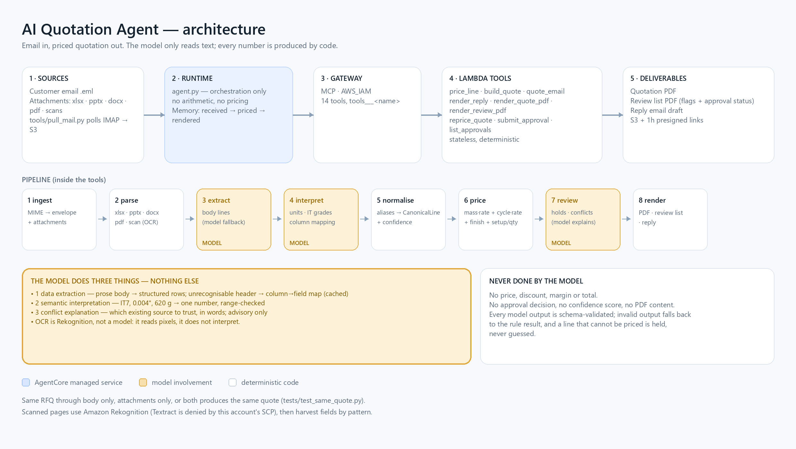

# AI Quotation Agent — Axrail take-home


An agent that takes a customer RFQ (email body plus Excel / PowerPoint / PDF attachments),
extracts the parts, prices them with deterministic tools, and produces a quotation PDF, a
reply email and an internal review list — with every number traceable to a source row and a
pricing rule.

The brief's sample RFQ (`tests/fixtures/02_rfq_full_attachments.eml`) gives:

```
BRK-100  AL6061   500 pcs   unit 26.86   line 13,430.00
SHF-220  SS304    200 pcs   unit 54.52   line 10,904.00
CVR-310  AL6061  1000 pcs   unit 50.35   line 50,350.00        total 74,684.00
SPC-050  SS304    qty TBC   → held (quantity to be confirmed)
HSG-400  Ti Gr5    50 pcs   → held (material not on the price list)
```

The same money comes out whether the parts arrive in the email body, in the attachments, or
in both — `tests/test_same_quote.py` asserts it.



---

## Pipeline

```
email (.eml, with attachments)
   │
   ├─ ingest      MIME → envelope (subject/from/date/body) + attachments on disk
   ├─ extract     body lines (regex → model fallback)  ·  xlsx / pptx / docx / pdf tables
   ├─ normalise   field aliases, units, material grades → one CanonicalLine per part
   │              + source conflict list + per-field confidence
   ├─ price       mass×material + cycle×rate + finish + setup/qty → margin → volume tier
   │              priced lines carry Trace records; unpriceable lines are held with the
   │              components that *can* be computed
   ├─ review      approval decision (amount, discount, holds, conflicts, low confidence)
   └─ render      quotation PDF · review-list PDF · reply email
```

Everything above runs inside a Lambda tool; the agent on AgentCore Runtime orchestrates and
stores state in AgentCore Memory. See `docs/architecture.md` for the per-node breakdown.

## Repo layout

```
src/quotation_agent/
  ingest/email_reader.py     MIME → envelope, attachments
  parsers/                   xlsx · pptx · docx · pdf · body  (+ table_mapper, mapping_cache)
  quote/                     normalise · confidence · pricing · render · values · arbitration
  store/db.py                SQLite layers: blob → raw → stage → mart
  pipeline.py                ingest + stage an email
  lambda_handler.py          14 gateway tools (price_line, build_quote, quote_email, …)
agent_runtime/agent.py       AgentCore Runtime entry point (BedrockAgentCoreApp)
tools/                       CLI tools, web UI, packaging and deploy scripts
tests/                       178 tests, fixtures for every input format
docs/                        architecture, AWS deployment, cost, demo script, data dictionary
```

## Setup

```bash
# Python 3.11+ and uv (https://docs.astral.sh/uv/)
uv sync                       # creates .venv with openpyxl / python-pptx / python-docx / pypdf

# optional: enable the model-assisted paths (see "Where the model is used")
export LLM_PROVIDER=openai
export LLM_BASE_URL=https://api.deepseek.com/v1
export LLM_MODEL=deepseek-chat
export LLM_API_KEY=...        # or LLM_KEY_PARAM=/quotation-agent/deepseek-api-key (SSM)
```

Nothing above is needed to run the deterministic pipeline or the tests — they are offline.
The commands below use `uv run`, so they work without activating the virtualenv.
If you prefer activating it, `.venv\Scripts\activate` (Windows) or `source .venv/bin/activate`
and then plain `python` works too.
To keep the local pipeline fully offline (no model fallback attempts), set
`LLM_EXTRACTION=0` before running the CLI tools.

## Run locally (no AWS)

```bash
# 1. ingest an email and parse its attachments into SQLite
uv run python tools/init_db.py --rebuild --store tests/fixtures/02_rfq_full_attachments.eml

# 2. price it
uv run python tools/build_quote.py --email 1

# 3. write the deliverables (quotation PDF, review list, reply email, text)
uv run python tools/deliver.py --email 1
```

`deliverables/<rfq_no>/` then contains `quote.pdf`, `review-list.md`, `reply-email.txt`
and `quote.txt`.

## Run the web UI

```bash
uv run python tools/ui.py     # → http://127.0.0.1:8765
```

Four pages:

| Page | Purpose |
|---|---|
| `/` | pick an email → quote it (attachments / body / both) → per-line `how?` trace and `why?` confidence → discount slider → generate PDFs at that discount → submit for approval |
| `/inbox` | read-only browser for every email in the S3 inbox (company / contact / search filters, original attachments) |
| `/approvals` | approval queue with status, reasons, flagged lines; approve or reject |
| `/prices` | the live price list and rules, read from the pricing code itself |

The UI is a thin local shell: it signs requests with your AWS credentials and calls a
deployed runtime. It needs two things — valid credentials (`aws login`) **and** a runtime
of your own; set `RUNTIME_ARN` to it (see `docs/aws-deployment.md` §1.8). Without a
deployed runtime the CLI above still works completely offline.

## Deploy to AWS

One-time infrastructure (S3 bucket, IAM roles, Lambda, AgentCore Gateway + target, Memory,
Runtime) is documented step by step in [`docs/aws-deployment.md`](docs/aws-deployment.md).
After that, two scripts cover day-to-day changes:

```bash
python tools/deploy_lambda.py            # package (x86_64 wheels) → S3 → update code + env
python tools/deploy_runtime.py           # package (arm64 wheels) → S3 → new runtime version
```

Configuration comes from environment variables (`RUNTIME_ID`, `RUNTIME_ROLE`, `GATEWAY_URL`,
`MEMORY_ID`, `S3_BUCKET`, `AWS_PROFILE`, `AWS_REGION`); both scripts print what they change
and wait for the resource to settle.

Invoke the deployed agent:

```bash
aws bedrock-agentcore invoke-agent-runtime \
  --agent-runtime-arn arn:aws:bedrock-agentcore:<region>:<account>:runtime/<runtime-id> \
  --runtime-session-id sess-demo-0001-abcdefghijklmnopqrstuvwxyz \
  --payload fileb://payload.json --cli-binary-format raw-in-base64-out \
  --region <region> out.json
```

`payload.json` is either `{"email_key": "inbox/x.eml", "mode": "both"}` or
`{"rfq_no": "...", "customer": "...", "body_text": "..."}`.

## Tests

```bash
uv run python -m unittest discover -s tests   # 178 tests, ~5 s, no network, no AWS
```

The pricing tool is covered directly — the brief's worked example, the volume tiers, and the
"hold instead of guess" cases:

| Test file | What it pins |
|---|---|
| `test_pricing.py` | `0.40×18 + 6×2 + 1.50 + 250/500 = 21.20`, margin, 5%/8% tiers, `hold_no_*` reasons |
| `test_e2e_quote.py` | the sample RFQ end to end: 3 priced lines, 2 held, total 74,684 |
| `test_same_quote.py` | body-only / attachments-only / both give identical lines and total |
| `test_lambda_tools.py` | the 14 gateway tools; reply email keeps the priced lines (regression) |
| `test_confidence.py` | source weights, agreement/conflict/missing scoring |
| `test_llm_intervention.py` | P1 mapping + cache, P2 unit conversions, P3 arbitration validation |
| `test_approval.py` | submit → list → approve/reject, flagged lines recorded |
| `test_parsers.py`, `test_body_parser.py`, `test_email_reader.py` | MIME and per-format parsing |
| `test_store.py`, `test_normalise.py`, `test_identity.py` | layering, aliases, customer resolution |

## Where the model is used

Exactly one job: **turning text into fields**. Prices, discounts, approvals, confidence and
PDFs are pure code, so the same RFQ always produces the same money.

| Step | When | Output |
|---|---|---|
| Body extraction | regex found no complete line (material / qty / tolerance missing) | structured rows, `llm line N` in the trace |
| P1 structure mapping | the header row cannot be recognised | column → field mapping, cached per template fingerprint |
| P2 value interpretation | tolerance or mass the rules cannot parse (`IT7`, `0.004"`, `620 g`) | a number, range-checked |
| P3 conflict arbitration | two sources disagree | which *existing* source to trust (advisory only) |

Flags: `LLM_MAPPING`, `LLM_VALUES` and `LLM_ARBITRATION` are all on by default; set any of
them to `0` to disable. Every model output is schema-validated, and invalid output falls back
to the deterministic result.

Scanned pages and screenshots are handled without a model: the PDF/image parser calls Amazon
Rekognition `DetectText` when a page has an image and no usable text layer or structure,
discards lines below 80 % confidence, and harvests fields by pattern (`400 pcs`, `tol ±0.10`,
`0.35 kg`). Unrecognisable spreadsheet headers fall back to the same text harvest.

## Design decisions

1. **The model never produces a number.** Pricing is a pure function over a literal price
   table; each line carries `Trace` records (rule id, inputs, amount, source locator).
2. **Hold, don't guess.** `hold_no_qty` / `hold_no_material` / `hold_no_rate` /
   `hold_no_tolerance` / `hold_no_mass_or_cycle` — each names the department that has to fix
   it, and shows the cost components that *are* known.
3. **Conflicts are reported, not resolved.** CVR-310 is 1,000 pcs in the Excel and 800 in the
   drawing; the quote keeps the weighted source and says so in the PDF, the review list and
   the reply.
4. **A number without a source is a bug.** Every line lists its source rows; the review list
   repeats the rule chain so a manager can retrace it.
5. **Confidence is explicit.** Where the brief leaves "what needs a person" to us, we score
   each field by source and agreement (see `docs/architecture.md` § Confidence). Agreement
   is counted per **document**: the same email body read once by regex and once by the model
   is one source, not two — a model re-reading a document is not corroboration.
6. **Format independence is a test, not a claim.**

## Cost per quote

A quote costs effectively nothing: the deterministic path makes no model call, and the only
panels that can call one are fallbacks. Model calls are ~1–2k tokens each and are cached per
template. AWS side: Lambda invocation, a few hundred ms of runtime, and a few KB of S3.
Details and the fixed-cost traps we avoided: [`docs/cost.md`](docs/cost.md).

## Region

Deployed in **ap-southeast-2 (Sydney)**, the region the account is pinned to. For a Malaysian
customer in production I would use **ap-southeast-1 (Singapore)**: Bedrock and AgentCore are
available there, it is the closest region to Malaysia (single-digit-ms latency, no
cross-region data transfer), and it keeps customer data in-region. The code has no
region-specific assumptions beyond configuration.

## Known limits

- **No mailbox integration out of the box.** `tools/pull_mail.py` polls an IMAP inbox (QQ
  tested) and drops `.eml` files into S3; SES inbound would need a domain and sandbox exit.
- **Approval routes to a queue, not a person.** Records land in `s3://…/approvals/` and are
  visible in `/approvals`; no email notification is sent yet.
- **Scanned drawings and photos go through OCR** (Rekognition `DetectText`); charts and
  diagrams still only yield their text labels, not the values plotted in them.
- **P1 mapping needs a table.** Sheets that are pure prose still fall back to the body/LLM
  path; charts and images are ignored.
- **Confidence weights are a judgement call**, not fitted to labelled history.
- **SQLite is local only.** The runtime is stateless; durable state lives in AgentCore Memory
  and S3.
- **Sample data is fictional.** The fixtures reproduce the brief's figures but are our own
  files, not the Drive originals.

## Docs

| File | Contents |
|---|---|
| [`docs/architecture.md`](docs/architecture.md) | pipeline, data model, module map, confidence, model policy |
| [`docs/aws-deployment.md`](docs/aws-deployment.md) | resources, invoke command, teardown |
| [`docs/cost.md`](docs/cost.md) | per-quote cost, levers, fixed-cost traps |
| [`docs/walkthrough.md`](docs/walkthrough.md) | real input/output of every stage |
| [`docs/demo-script.md`](docs/demo-script.md) | recording plan with timings |
| [`docs/db-schema.xlsx`](docs/db-schema.xlsx) | data dictionary (10 tables, 93 fields, source per field) |
