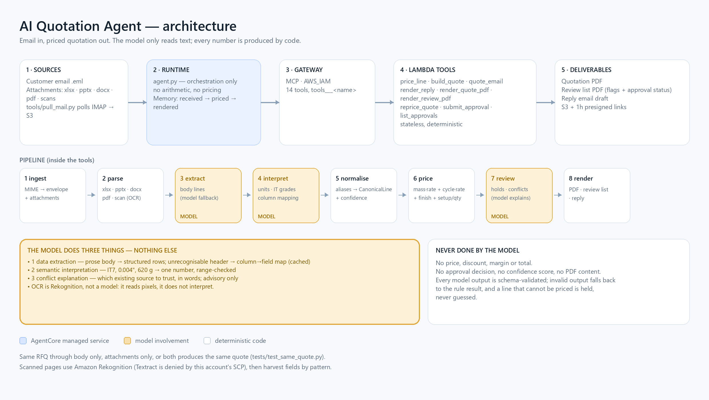

# Architecture



*Regenerate with `python tools/make_architecture_diagram.py` (Pillow, no browser needed).*

## The problem in one paragraph

A CNC shop receives an RFQ as an email plus attachments (Excel, PowerPoint, PDF,
Word). An estimator reads it, looks up prices, does the arithmetic, and writes back.
The parts are usually repeated across files, the files disagree with each other, and
some lines cannot be priced at all. The agent has to do the legwork without ever
inventing a number, and it has to hold back whatever needs a human.

## Pipeline

```
             ┌──────────────┐
 email  ───► │ 1  ingest    │  .eml ──► Envelope (sender, subject, RFQ no, attachments)
             └──────┬───────┘
                    ▼
             ┌──────────────┐
             │ 2  parse     │  email body / xlsx / pptx / docx / pdf ──► stage_block
             └──────┬───────┘      (text, table_row, kv, title + locator)
                    ▼
             ┌──────────────┐
             │ 3  normalise │  blocks ──► CanonicalRFQ (+ conflicts, + refs)
             └──────┬───────┘
                    ▼
             ┌──────────────┐
             │ 4  price     │  CanonicalRFQ ──► priced lines / held lines
             └──────┬───────┘      (pure functions over a price table)
                    ▼
             ┌──────────────┐
             │ 5  render    │  quotation PDF + reply draft + review list
             └──────────────┘
```

Each arrow is a testable seam. `tests/test_e2e_quote.py` drives the whole chain from
an `.eml` file to a stored quote; every stage also has its own tests.

## Data model (SQLite, `data/email_extract.db`)

Four layers, so that "what arrived" is never mixed with "what we made of it":

| Layer | Table | Meaning |
|---|---|---|
| blob | `blob_store` | original bytes, addressed by sha256; inline up to 1 MiB, else file path |
| raw | `raw_email` | one row per email (idempotent by content hash), with envelope fields: subject, sender, recipients, sent_at |
| raw | `raw_attachment` | attachment as a child of the email (`raw_email_id`), with its blob and on-disk path |
| run | `parse_run` | one row per parse: which input, which parser version, ok/failed |
| stage | `stage_email` | parsed headers, body, RFQ ids, customer resolution |
| stage | `stage_attachment` | attachment parse status + warnings (`needs_ocr`, …) |
| stage | `stage_block` | the smallest extracted unit, each with a `locator` |
| mart | `mart_rfq` | the finished quote (`payload_json`), rebuildable |

Why the split matters: if a parser improves, re-run it over `blob_store` and get a
second `stage_email` with its own `run_id`. The customer never has to resend anything.

## Module map

```
src/quotation_agent/
  pipeline.py            orchestration: ingest → parse → build quote
  models.py              Envelope, AttachmentRef, Provenance
  identity.py            customer resolution with weighted evidence + confidence
  cli_util.py            UTF-8 stdout for Windows consoles

  ingest/email_reader.py .eml → Envelope, headers-only fast path, attachment staging

  parsers/base.py        block constructors, header detection, dispatch by suffix
  parsers/body_parser.py part lines written inline in the email body
  parsers/xlsx_parser.py header row anywhere in the sheet, messy values kept raw
  parsers/pptx_parser.py tables + slide text + speaker notes
  parsers/docx_parser.py paragraphs and tables in document order
  parsers/pdf_parser.py  colon-style lines and Field/Value column layouts; needs_ocr

  store/db.py            schema, blob CAS, raw entities, stage writes, data dictionary

  quote/normalise.py     aliases, value parsing, cross-file merge, conflict detection
  quote/pricing.py       the price table and price_line() — pure, no I/O
  quote/build.py         assemble the quote, decide approval, write mart_rfq
  quote/model.py         CanonicalLine, Conflict, PricedLine, HeldLine, Quote, Trace
  quote/pdf.py           dependency-free PDF writer
  quote/render.py        quotation PDF, reply email, review list
```

## Design decisions worth defending in the interview

1. **The model never produces a number.** Pricing is `price_line(line)` over a literal
   price table. Every priced line carries `Trace` records: rule id, inputs, amount,
   and the source locator the input came from.

2. **A line that cannot be priced is held, not guessed.** Three distinct reasons:
   `hold_no_qty` (quantity TBC), `hold_no_material` (material not on the price list),
   `hold_no_rate` (tolerance tighter than any standard rate). A generic "unknown"
   would hide which department has to fix it.

3. **Conflicts are reported, not resolved.** CVR-310 is 1,000 pcs in the Excel and
   800 pcs in the drawing Rev B. The quote is built from the RFQ quantity, the
   conflict is listed in the PDF assumptions and in the reply email, and the review
   list shows both sources with locators.

4. **Format independence is a test, not a claim.** The same RFQ delivered as
   Excel+PPT+PDF and as messy-Excel+Word+scanned-PDF must produce the same money;
   `test_two_formats_same_quote` asserts it.

5. **Headers are read even when parsing fails.** Envelope fields are written at ingest
   time from the mail headers alone, so a parser crash never makes an email unlisted.

6. **Confidence is explicit, not implied.** See the next section — the brief leaves
   "what needs a person" to us, so the rule is written down, tested and shown per line.

## Confidence

The brief does not ask for a confidence score; it asks us to decide what the agent may
do alone and what needs a person (§4, "Where the brief is unclear, make a reasonable
assumption, state it"). A score makes that decision mechanical, visible and testable.

Implementation: `src/quotation_agent/quote/confidence.py`, applied in `merge()`.

**Per-field weight** (the field is taken from the most reliable source first):

| Source | Weight | Why |
|---|---|---|
| `xlsx` / `pptx` / `docx` | 0.90 | customer's own structured table |
| `pdf` | 0.70 | text pulled out of a drawing loses context |
| `body` | 0.60 | free prose |
| `llm` | 0.45 | a second-hand transcription of the prose |

**Per-field score**, with `n` = number of sources carrying that field:

```
all sources agree : min(0.99, max(weight) + 0.05 * (distinct documents - 1))
                    # the same body read by regex and by the model is ONE document
sources disagree  : 0.30            (and a Conflict record is written)
single source     : weight(source)
missing / "TBC"   : 0.40            (flagged as "not stated", not as a conflict)
```

**Line score** = `min(score(qty), score(material), score(tol))`. Description, mass, cycle
and finish are recorded but do not gate the line.

| Line score | Label | Behaviour |
|---|---|---|
| ≥ 0.85 | `high` | nothing special |
| 0.55 – 0.85 | `medium` | nothing special |
| < 0.55 | `low` | red badge, `flags` listed under the row, quote gains an approval reason |

Conflict resolution follows the same weights: the winning value comes from the highest
weighted source (Excel beats drawing beats prose), and the losing values stay in the
conflict record with their locators. Example: CVR-310 keeps 1,000 pcs from
`part_list.xlsx!A7` and reports 800 pcs from `drawing_CVR-310_RevB.pdf page 1 L13`.

Limitations, stated rather than hidden: the weights are a judgement call, not fitted to
data; a badly filled spreadsheet still scores 0.90; "TBC" and a genuinely absent value
are scored the same. Calibrating them would need labelled history (which quotes were
later corrected), which a demo does not have.

## Where the model is allowed to help (three jobs)

The model does exactly three jobs — **data extraction**, **semantic interpretation** and
**conflict explanation** — through four entry points (body fallback and P1 mapping are both
extraction). OCR is not a model: Rekognition reads pixels, it does not interpret.

Rules alone break on real customer files, so three narrowly-scoped model steps exist. Each
one only *interprets*; the values are still read and computed by code, and every output is
validated before use.

| Step | Trigger | Model output | Validation | Cache |
|---|---|---|---|---|
| **P1 structure mapping** | the header row cannot be recognised (`no_table_header`) | `{header_row, columns: {"D": "qty"}, units, confidence}` — column → field only | column exists · field known · no duplicate · `part_no` present · ≥3 fields · sample values parse | fingerprint of the first rows → `mapping_cache/<hash>.json` in S3; a known template never calls the model again |
| **P2 value interpretation** | a tolerance or mass that the rules cannot parse (`IT7`, `0.004"`, `4 µm`, `620 g`) | a number + unit | range check (tol 0.001–50 mm, mass 0.001–500 kg) | none needed (deterministic conversions are the primary path) |
| **P3 conflict arbitration** | two sources disagree | which *existing* source to trust, plus a reason | the suggested source must be one of the conflict's own sources | none |

Flags: `LLM_MAPPING` (on by default), `LLM_VALUES` (on by default), `LLM_ARBITRATION` (on by
default); set any of them to `0` to disable. P3 is advisory only: the quote keeps using the
weighted source, and the human still sees the conflict.

**Scanned pages are not a model step.** OCR (Amazon Rekognition `DetectText`) is a
deterministic fallback inside the PDF/image parser: it fires per page when the page has an
image and either no text layer (fewer than 20 characters) or no usable structure (no
key/value, no table row, no part number). Word bounding boxes are sorted top-to-bottom so
the text reads in order, then `parsers/ocr_rows.py` harvests fields by pattern (part number,
`400 pcs`, `tol ±0.10`, `0.35 kg`, `5 min`) because OCR drops punctuation. Lines below 80 %
confidence are discarded. Spreadsheets cannot be OCR'd (there is no renderer in Lambda), so
an unrecognisable xlsx header falls back to the same text harvest instead.

Deterministic conversions ship first, so most files never reach the model: `±0.10`,
`+0.10/-0.02` (tighter side), `0.004"` → 0.1016 mm, `4 µm` → 0.004 mm, `IT7` → 0.025 mm
(approximate, noted), `620 g` → 0.62 kg.

Failure behaviour in every case: fall back to the rule result, keep the warning, let the line
be held or flagged — never invent a value.

## Tests

`python -m unittest discover -s tests` — 87 tests.

| File | Covers |
|---|---|
| `test_email_reader.py` | MIME edge cases: HTML-only, attachments, collisions, encoding |
| `test_identity.py` | evidence weighting, conflicts, public mailboxes |
| `test_step1_fixtures.py` | 11 fixture emails through the envelope stage |
| `test_fixture_attachments.py` | the attachment corpus is readable / broken file fails |
| `test_parsers.py` | header detection, speaker notes, Field/Value PDFs, needs_ocr |
| `test_store.py` | blob CAS, parentage, idempotency, re-parse creates a second stage row |
| `test_normalise.py` | alias mapping, dirty values, conflict detection |
| `test_pricing.py` | the brief's worked example, tolerance boundary, all three holds |
| `test_render.py` | PDF text content, English-only PDF, reply questions, trace completeness |
| `test_e2e_quote.py` | whole chain + two formats → same quote |

## Known limits

- Email is imported from `.eml` files; no IMAP/Gmail polling (a real deployment would
  swap the source and keep the rest of the pipeline unchanged).
- Scanned PDFs report `needs_ocr` rather than guessing; OCR is not wired in.
- The reply email is a draft in `deliverables/`, not sent from the agent.
- The AgentCore deployment (Runtime + Gateway + Memory) is the next step; the code is
  already split so the pricing/validation tools can be exposed through Gateway as-is.
